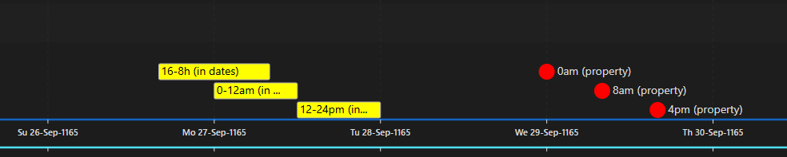

[< Back to calendar overview](calendars/)

---

## What is Time of Day?

Time of day lets you position events within a single day rather than snapping every start or end point to a whole-day boundary.
Internally, time of day is expressed as a fraction of one day. Events get moved by that fraction between two ticks on the calendar axis.

This is completely optional. In fact, for a fantasy timeline stretching over thousands of years, it makes little sense to use.

---

## How to configure Time of Day?

Time of day values are attached to events or calendar settings depending on how your timeline rules and frontmatter properties are structured.

1. [[#Time of Day configuration]]
2. [[#Supported Values]]
2. [[#Fractional Day Behavior|Fractional Day Behavior]]
3. [[#Examples|Examples]]

> [!info] To read about common configuration sections, see [here](calendars/).

---

## Time of Day configuration

To be able to define any time of day you will have to update your calendar configuration.
The top-level parameter you need is named `timeOfDay`, it accepts a list of objects containing 3 values each:

- `unit`: An optional string and name of the unit. This is for you, the plugin ignores it.
- `count`: A mandatory number (positive integer).
- `names`: An optional list of strings of size `count`. May be used in the tooltip later.

### Example configuration

The example displays what the configuration would look like for the Gregorian calendar.
You don't have to use the complete example, in fact I would suggest omitting seconds since they won't make a difference in rendering.

```yaml
timeOfDay:
  - unit: hour # this is for you, the plugin ignores it
    count: 24 # since this is the first unit, the plugin assumes 1 day = whatever you defined
  - unit: minute # see above
    count: 60 # since this is not the first one, the plugin splits the previous unit into this many parts
  - unit: second
    count: 60
```

## Supported Values

Time of day values parse clock-style strings into fractional day offsets (`0.0` to `1.0` across any day).
To define a time of day just place it behind your start or end date, separated by a space.

```yaml
gantt-name: "Yet another meeting"
gantt-start: "2026-11-26 09:30"
gantt-end: "2026-11-26 10:30"
```

If you want to add the same time of day to both start and end, you may use the `gantt-time` property.

```yaml
gantt-start: "2026-11-18"
gantt-end: "2026-11-26"
gantt-time: "12:00"
```

---

## Rendering

A new setting lets you decide whether to shift the events on the timeline by their respective time of day. If deactivated, the time of day get ignored when choosing rendering events.



In any case, events of the same day get sorted vertically by their respective start time from top to bottom.

Click to see some [calendar examples](example-calendars/).

---

> [!info]- Property traits
> 1. Time of day fields are **optional**; omitting them defaults to no offset (0am).
> 2. Whole-day fields (`startDays`, `endDays`) remain separate from parsed time-of-day fractions.
> 3. Base calendar and event properties still apply as usual.

