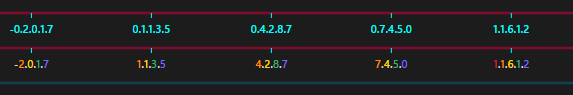

[< Back to calendar overview](calendars/)

---

## What is a Positional Calendar?

Positional calendars represent dates as a sequence of interlocking fixed-length units.
A famous real life example would be the [[mayan-calendar|Mayan calendar]] which was supposed to end in 2012.
Its format could look like: `13.0.11.4.0`

Unlike rule-based calendars, positional calendars do not use months, leap years, or variable cycle lengths. Every unit equals an exact, static number of days.

---

## How to create a Positional Calendar?

To define a positional calendar, set the YAML property `'type'` to `'positional'`.
A positional calendar contains 2 configuration sections that distinguish it from a "normal" calendar:

- [[#Positional Units|units]] (mandatory)
- [[#Positional Details|details]] (optional)
- [[#Positional Date Shortcuts|Shortcuts for positional dates]]

> [!tip] To read about common configuration sections, see [here](calendars/).

---

### Positional Units

The core of a positional calendar is the `'positionalUnits'` list. Each entry defines a digit position from **largest to smallest**.
The [[mayan-calendar|Mayan calendar]] would look like this:

```yaml
type: positional
delimiter: "."
positionalUnits:
  - name: Baktun # Display name of a unit
    days: 144000 # Exact number of days contained in the unit
    color: red   # Optional hex/CSS color for this specific unit on the axis.
  - name: Katun
    days: 7200
  - name: Tun
    days: 360
  - name: Uinal
    days: 20
  - name: Kin
    days: 1
    color: "#00ffff"
```

> [!tip]+ Unit Ordering
> Always order `'positionalUnits'` from the **largest** day count at the top down to the **smallest** (typically `1` day) at the bottom.
>
> All internal timeline, offset, and duration calculations in the plugin operate strictly in whole days. Make sure any unit lengths, offsets, and event dates you configure map cleanly to integer day counts so positions and intervals stay exact.

---

### Positional Details

The details section is optional, it allows you to *change how your dates are rendered*.



```yaml
positionalDetails:
  oneBased: true | false
  hideLeadingUnits: true | false
  colorAxisDates: true | false
```

The entire section is optional, as are all of the boolean keys.
All booleans default to `false` if omitted.

- **`oneBased`** *(boolean, default: `false`)*: By default, units start counting at `0` (e.g., `0.0.0.0.1`). Set to `true` to start counting at `1` (e.g., `1.1.1.1.1`).
- **`hideLeadingUnits`** *(boolean, default: `false`)*: Omits leading zeros (or ones, if `oneBased`) units from rendered date labels (e.g., `0.0.3.4.0` becomes `3.4.0`).
- **`colorAxisDates`** *(boolean, default: `false`)*: Colors each individual unit segment on the calendar axis using the `color` defined in `'positionalUnits'`.

> [!warning]+ Date Format in Events
> Event dates referencing a positional calendar must follow the exact unit sequence separated by your configured `'delimiter'` (e.g., `13.0.11.4.0` when `delimiter: "."`).

Click to see some [calendar examples](example-calendars/).

---

### Positional Date Shortcuts

Imagine using a positional date with 15 segments. Who would want to do that? Don't ask, you can.

The regularity of positional dates allows you to use some shortcuts in your date input. These may shorten your work by a considerate amount.

- [!] **Omitted leading units:**

You can omit the topmost units and fill them automatically (`1` for one-based calendars, `0` for zero-based calendars), such as `9.1.1` or a single value like `5`.

```yaml
gantt-start: 3.4.5 # equals "0.0.0.3.4.5" in a 0-based 6-segment calendar
```

- [!] **Trailing delimiter:**

Ending a date with your delimiter (such as `2.`) counts from the top unit and fills the remaining lower units with `1` (one-based) or `0` (zero-based).

```yaml
gantt-start: 3.4.5. # equals "3.4.5.0.0.0" in a 0-based 6-segment calendar
```

- [!] **Repeats (`*`):**

Use `<count>*<value>` (with `<count>` as a whole number from `1` up to the unit count) to repeat a value.
This can can be combined with omitted leading units or a trailing delimiter.

```yaml
gantt-start: 3*2.3*4 # equals "2.2.2.4.4.4"
```

---

> [!info]- Property traits
> - `'type'` (`'positional'`) and `'positionalUnits'` are **mandatory** for positional calendars.
> - `'positionalDetails'` and all its sub-properties are **optional**.
> - Base properties like `'id'`, `'sharedOffset'`, and `'delimiter'` still apply as usual.
